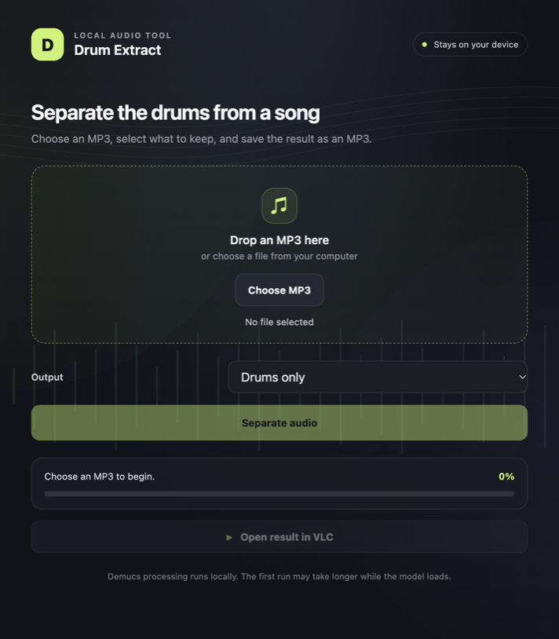
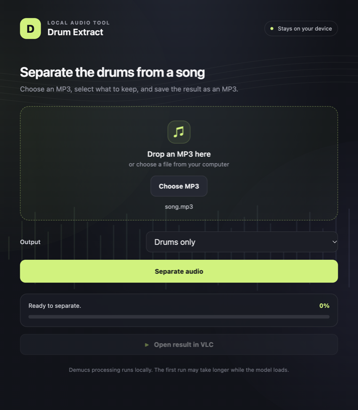
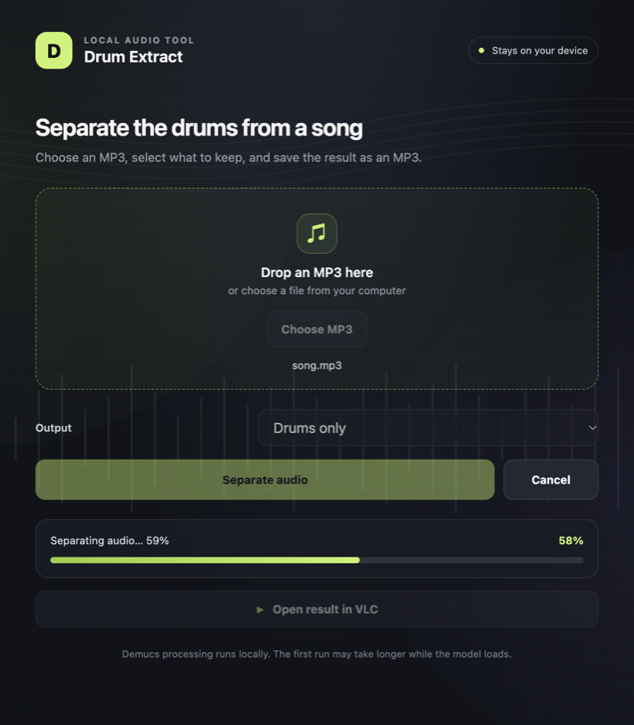
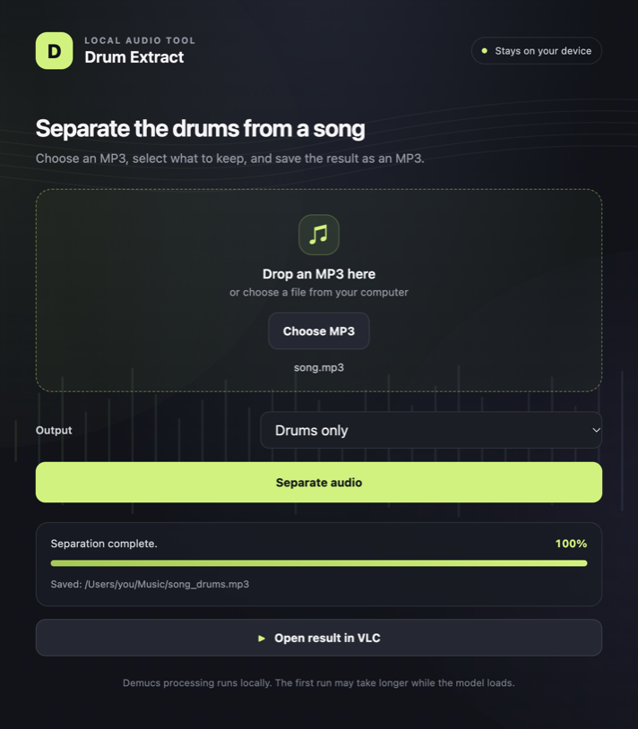

# Drum Extract

A local desktop app for separating drums from MP3 files. Electron provides the interface; the Python CLI in `CLI/` runs Demucs, then FFmpeg converts the selected WAV stem to an MP3. The WAV stem and other intermediate Demucs stems are temporary and cleaned up; VLC opens the final MP3.

## Project layout

```text
CLI/                  Python command-line backend
  drum_extract.py
  __init__.py
electron/              Electron main process, preload bridge, and renderer UI
tests/                 Python unit tests
docs/screenshots/      README images
AGENTS.md              Canonical instructions for coding agents
pyproject.toml         Python project and uv dependencies
package.json           Electron scripts and dependencies
```

## Requirements

- Python 3.12 or newer and `uv`
- Node.js and npm
- FFmpeg installed and available on `PATH`, with the `libmp3lame` encoder
- VLC installed to play the result in VLC

## Set up

From the project directory, install the Python and Electron dependencies once:

```bash
uv sync
npm install
```

`uv sync` creates `.venv/`, which the Electron app uses to run the Python backend. If you later see "The Python environment is missing" in the app, re-run `uv sync`.

## Using the desktop app

Launch the app with:

```bash
npm start
```

`npm start` runs `electron .` and loads `electron/main.cjs`. It is the only launch script; there is no separate `dev` script, and the app has no build step, so edit the files under `electron/` and restart to see changes. `npm run check` syntax-checks the Electron sources.



*The app before selecting a song.*

Then, in the window:

1. **Pick a song.** Drag an MP3 onto the drop zone, or click **Choose MP3** to open a file dialog. Only `.mp3` files are accepted; video files are rejected.
2. **Choose what to keep.** In the dropdown, select **Drums only** (isolated drum stem) or **Everything except drums** (the mix with drums removed).
3. **Separate.** Click **Separate audio**. A save dialog opens first, pre-filled with `<song>_drums.mp3` or `<song>_no_drums.mp3` beside the input; pick a location and confirm. Cancelling the save dialog aborts without processing.
4. **Wait.** The progress bar follows Demucs inference, holds at 97% while FFmpeg encodes, and reaches 100% only after the final MP3 has been written. The first run downloads the `htdemucs` model, which takes a little longer. Click **Cancel** to stop an in-progress separation; nothing is written when you cancel.
5. **Listen.** Click **Open result in VLC** to play the saved MP3. VLC must be installed.

### What it looks like



*An MP3 is selected and ready to process.*



*Demucs is running; the Cancel button is available.*



*The completed MP3 can be opened in VLC.*

The app always uses `--device auto` (CUDA, then Apple Metal/MPS, then CPU) and falls back to CPU automatically if the GPU run fails. On an Apple Silicon Mac a four-minute song takes roughly 20 seconds on MPS versus over a minute on CPU.

On macOS, closing the window leaves the app running in the Dock, following the platform convention; press Cmd+Q (or stop `npm start` in the terminal) to quit. On Windows and Linux, closing the window quits. Quitting during a separation terminates the backend and cleans up its temporary files.

Audio is processed locally and is not uploaded. The temporary WAV, unused Demucs stems, and any failed partial MP3 are cleaned up; only a successfully converted MP3 is kept. FFmpeg is used to encode the WAV stem because it is much faster than Demucs' built-in `lameenc` MP3 path.

## Command-line use

```bash
uv run drum-extract song.mp3 --mode drums
uv run drum-extract song.mp3 --mode no-drums
uv run drum-extract song.mp3 --mode drums --device auto
```

Or invoke the module directly:

```bash
uv run python CLI/drum_extract.py song.mp3 --mode drums
```

`--device` accepts `auto`, `cpu`, `mps`, or `cuda`; `auto` chooses CUDA, then MPS, then CPU, and retries on CPU if an automatic GPU run fails. An explicitly selected device is not retried. Use `--output path/to/result.mp3` to select an output path and `--overwrite` to replace an existing MP3. Use `--model htdemucs_ft` to try the slower fine-tuned model.

## Checks

```bash
uv run python -m unittest discover -s tests -v
npm run check
```

Source separation is approximate and may leave drum bleed or other artifacts. NumPy is constrained below version 2 because the installed PyTorch build is not compatible with NumPy 2.x.
